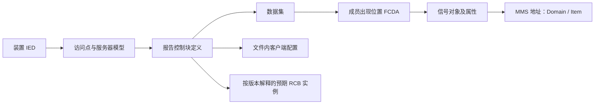

# Task6 · MMS 离线解析与面向初学者的查阅工作台

日期：2026-11-19。状态：**T6.0–T6.2 已通过，T6.3–T6.5 未实施**。基线与保守支持范围见 [T6.0](Task6T6.0.md)，独立合成数据交互原型见 [T6.1](Task6T6.1.md)，纯 Qt Core 投影及增量规则见 [T6.2](Task6T6.2.md)。正式程序尚未接入新的 MMS 快照查询或页面。

## 1. 需求结论与默认决策

需求足以进入设计，没有阻止方案工作的矛盾。产品目标是：打开 SCL 后，让不熟悉 IEC 61850 的用户也能查清“装置有哪些信号、哪些信号通过报告上送、报告如何配置、地址是什么、文件依据在哪里”。

有三处需要校正理解：

1. 仓库中的 Task5 实际位于 `docs/Tasks/Task5.md`，不是 `docs/Task5.md`。它重点改进 GOOSE/SV 成员、描述和详情；并非已经覆盖全部 MMS 业务。
2. MMS 并非完全没有解析。现有高级视图已有报告定义、原始 rptID、数据集引用及部分 MMS 映射；缺少系统的业务投影、报告实例/客户端配置、连接信息和易理解的导航。应补齐现有能力，避免另起解析器。
3. “MMS 报文 ID”不是一个可以照搬 GOOSE/SV APPID 的单一配置字段。下文拆分为信号地址、报告控制块引用、报告标识和在线报文字段，界面不再使用含糊的总称。

默认范围：**离线、只读、无需 Redis**；继续 Qt Widgets + ADS；MMS 报告配置是第一优先级，同时交付信号地址目录和连接配置查阅。读取/写入、遥控、报告订阅、抓包和实际报文解码另立任务。设置组、日志及文件服务本期只展示已有声明与覆盖状态，不承诺完整专页或协议实现。

不需要用户先补充协议知识。以下资料在对应验收阶段补齐即可：

| 信息 | 当前处理 | 何时需要 |
| --- | --- | --- |
| 测试 SCD | 用户修订为 `D:/1Document/自动配置/电校scd/湖北武汉220kV电校培训变20261021.scd`；T6.0 已只读解析并取得基线 | T6.5 使用同指纹文件复测 |
| 厂家/标准版本及工程类型 | 从可读文件提取版本线索，未知时降低解释与校验覆盖；不从文件名/日期推断版本 | 默认值、实例命名及版本相关检查启用前 |
| 现场实际 RCB 名称或希望对照的客户端 | 可选，不阻塞离线功能；以后如有脱敏目录/抓包，单列在线对照 | 用户确需证明与设备一致时 |
| 独立程序目录 | 用户修订为 `D:/Code/IEC61850Simulator/tools/`，路径可访问；本任务无需新增独立程序 | 以后新增程序使用该目录 |

不得擅自替换指定真实样本为其他旧工程，再把旧结果记作本次验收。原文件不上传、不提交、不复制进测试夹具。

## 2. 现有能力与真实缺口

本节来自源码与阶段记录核对，不等于本轮执行了程序测试。

| 位置 | 已有能力 | 本任务补齐 |
| --- | --- | --- |
| `src/iec61850/scl/SclReferenceResolver.*` | ReportControl → 同 LN 数据集；FCDA 类型/引用解析；ldName 或 IED 名 + LD inst 的 Domain；ServerAt 跟随；Report 类 ExtRef 识别 | 报告参数与版本化实例语义、客户端声明、MMS 类型地址及证据状态；复用已有作用域与歧义处理 |
| `ReportMapping` | 原始 rptID、声明 datSet、派生数据集引用、定义引用和 MMS Domain/Item | 独立表示定义、预期实例、默认解释依据和限制；当前以 name 拼出的映射不能自动称为设备实际实例 |
| `src/core/SclTaskIndex.*` | 信号目录、数据集使用、GOOSE/SV、成员关系与描述复用 | MMS 报告索引、客户端配置反查、信号地址按需查询 |
| `src/gui/SclWorkspace.cpp` | 高级“报告”表、属性、引用及原文 | 保留技术入口，与新任务导航使用同一选择身份 |
| `src/gui/SclTaskPages.*`、`SclTaskBrowser.*` | 概览、信号、GOOSE、SV、检查、收发关系；后台筛选及历史 | 增加 MMS 查阅流程，减少用户理解并行 Tab 的负担 |
| `SclConnections` / `SclConnectionView` | 有界树、200 行成员分页、局部 Graphics View 图及取消 | 复用表格/图呈现能力；报告客户端关系采用独立语义，不能硬套 GOOSE/SV 匹配逻辑 |
| `docs/Tasks/SclRules.md` | XML、部分内部一致性；ENG002～004 与完整 XSD 尚未实现 | 本任务明确增量规则；不能把原“校验”入口宣传为完整性证明 |

[T5.6](Task5T5.6.md) 的完整验收尚未通过：其样本 Ready 中位数较 T5.0 增长 42.6%，部分表格交互推广及人工走查仍未完成。Task6 不改写该结论；T6.0 取得当前同机基线后，只能在已通过的增量门槛上继续。Task3 性能归因和 Task1 P7 完整 XSD 保持独立。

## 3. 给初学者的概念模型

### 3.1 先回答业务问题，再展开技术结构

可以把一个 IED 理解为一台提供数据的装置，LD/LN/DO/DA 是其内部数据地址层级。数据集是按顺序选出的一组数据引用；报告控制块决定采用哪个数据集、在什么条件下上送。MMS 也承载其他客户端/服务端服务，不能把“MMS”与“报告”视为完全同义。IEC 的映射范围说明见 [IEC 61850-8-1 官方说明](https://webstore.iec.ch/en/publication/6021)。



图中箭头表示配置归属/引用，不表示现场已有数据流。成员出现位置与信号目标是两个身份：同一信号重复出现在数据集中时必须保留各个原始序号。

### 3.2 明确区分各类“ID”

| 名称 | 用户可理解的含义 | 展示约束 |
| --- | --- | --- |
| SCL `ReportControl/@name` | 文件中的报告定义名 | 原字段，不等同于加后缀后的实例名 |
| RCB 定义引用 | 报告定义所属的 LD/LN 与类型位置 | 标为定义层派生引用 |
| 预期 RCB 实例引用 | 按已确认版本、indexed、RptEnabled 等解释出的实例地址 | 标为离线推导；无法确认命名时保留限制，不拼成确定地址 |
| 原始 `rptID` | 文件声明的报告标识字符串 | 缺失、空字符串和显式值分开；不自动覆盖原字段 |
| 默认/派生 RptID | 适用规则确认后，解释可能采用的默认报告标识 | 与原始 rptID 分列；不能代表在线实际值 |
| MMS Domain + Item | 访问某个模型变量的技术地址 | 对象属性、RCB 变量分别标类别；保留 FC 和数组访问语境 |
| 数据集 MMS 名称 | MMS 命名变量列表的名称 | 与变量 Item 分型；常见 domain 内名称为 `LNName$DataSetName` |
| invokeID | 在线确认服务请求/响应的关联字段 | 静态 SCL 不提供，不作为报告唯一编号 |
| SqNum、EntryID 等 | 实际报告的运行信息 | 可展示 OptFields 是否声明携带相应字段，不能制造实际值 |
| GOOSE appID / SV smvID / 数值 APPID | 其他通信服务的不同标识 | 不改名为 MMS ID，不与 rptID 混在同一列 |

libiec61850 的报告接口分别处理 RCB 引用、RptId 及收到的报告字段，可作为产品术语的交叉核对：[官方报告 API](https://support.mz-automation.de/doc/libiec61850/c/latest/group__IEC61850__CLIENT__REPORTS.html)。数据集对应命名变量列表的区别见 [官方模型目录 API](https://support.mz-automation.de/doc/libiec61850/c/latest/group__IEC61850__CLIENT__MODEL__DISCOVERY.html)。这些资料不表示本项目已接入在线库。

### 3.3 字段解释示例

以下完全为合成示意：假设 Domain 已唯一解析为 `DemoLD0`，LN 为 `LLN0`，报告定义 `brStatus`；在已确认规则下为 buffered 报告且存在索引实例 `01`：

| 项目 | 示例 |
| --- | --- |
| 定义层引用 | `DemoLD0/LLN0.BR.brStatus` |
| 预期实例引用 | `DemoLD0/LLN0.BR.brStatus01` |
| 预期实例 MMS Item | `LLN0$BR$brStatus01`，Domain 独立为 `DemoLD0` |
| 数据集引用 / MMS 列表名 | `DemoLD0/LLN0$dsStatus` / `LLN0$dsStatus` |
| 信号对象引用 | `DemoLD0/XCBR1.Pos.stVal`，FC 为 `ST` |
| 信号 MMS Item | `XCBR1$ST$Pos$stVal` |

示例不是把所有 name 都追加 `01` 的算法，也不是实际设备承诺。数据集的原始 `datSet="dsStatus"` 与派生完整引用同时保留。配置中的 `Val` 一律称“文件声明值”，不能显示成实时位置或实时遥测。

## 4. 信息架构与操作方案

### 4.1 外层按任务导航，内层按当前对象逐级深入

沿用已有工作台和独立 ADS 管理器。主导航改为左侧任务入口，默认不把多个技术表 Tab 平铺给初学者：

```text
工程：Demo.scd    范围：[整个工程 / 当前 IED]    [全局搜索：整个工程]
┌ 任务导航 ──────────┬──────────────────────────────────────────────┐
│ 工程概览          │ 装置 A › MMS 查阅 › 报告上送 › brStatus       │
│ 信号查阅          │ [返回] [前进]   当前列表筛选   [技术字段]      │
│ MMS 查阅          │                                              │
│   报告上送        │ 报告列表 → 所选报告摘要 → 数据集成员表       │
│   信号地址        │                                              │
│   连接配置        │ 选中内容的局部关系 [按需展开]                 │
│ GOOSE / SV        ├──────────────────────────────────────────────┤
│ 收发关系          │ 属性与依据：所选报告 / 所选成员               │
│ 文件检查          │ 字段值、来源、[查看原文]、[定位定义]           │
│ 高级视图          │ 原文标题明确当前字段及来源，支持返回           │
└───────────────────┴──────────────────────────────────────────────┘
```

这是信息结构线框，不要求新增一组 Dock，也不要求固定增加多列。任务导航与结构树共享现有左侧容器，可切换“任务 / XML 结构”；高级视图保留原技术表，不重复维护一份模型。中央内容通过 `QStackedWidget` 路由；底部/侧部现有 inspector 继续作为唯一工作对象详情。

本方案沿用原生系统字体、现有主题与工程软件密度。图标加中文文字，重点用标题、缩进和对齐表达关系；不引入装饰图片。窄窗的左右子区域改为同页前后层级，保留返回按钮，详情仍可收起；不把最小尺寸抬高到旧窗口无法使用。

### 4.2 四条主查阅路径

| 用户问题 | 操作路径 | 必须看见的答案 |
| --- | --- | --- |
| 这台装置向监控上送什么？ | 选 IED → MMS / 报告上送 → 选报告 → 看成员 | 报告类型、数据集、成员说明、引用及声明客户端；没有客户端声明时明确未知 |
| 某个信号的 MMS 地址是什么？ | 信号地址搜索 → 选对象 → 展开属性 | 对象说明、FC、Domain、Item、结构/数组访问、地址生成依据；未入数据集也能查 |
| 这个报告配置给谁？ | 报告 → 客户端配置；也可从客户端反查 | ClientLN/关联声明的原字段、解析目标、预期实例关联及证据；不称为已订阅 |
| 哪个配置有问题，原文在哪里？ | 文件检查 → 选问题 → 查看关联对象/原文 | 已执行规则、受限原因、同快照来源和修查建议；返回后恢复报告及成员 |

“监控上送”只是业务理解入口，不能仅凭名称判断真实客户端角色。整个工程可汇总报告；选择 IED 后列出该装置提供的报告，另有“作为客户端的文件声明”入口，避免把服务器报告与客户端使用混为一表。

### 4.3 报告页面

首屏报告列表默认列：报告定义名、描述、所属 IED/LD/LN、缓冲/非缓冲、数据集、原始成员数、配置状态。技术列按需展开原始 rptID、预期实例数、confRev、地址等。不能每个实例重复复制一份完整成员表。

选中后展示：

1. **报告摘要**：这份报告使用哪个数据集；文件声明的类型及参数。`buffered` 解释为缓冲报告类型；`bufTime` 是事件合并等待相关配置，不能混成一个“缓存时间”。
2. **上送内容**：成员每页最多 200 行，保留原始序号；列出对象名/描述与来源、属性名/描述、对象引用、FC、解析状态。DO 级成员标“对象成员”，可按需展开其属性，不伪装为单一 stVal，也不推断实际报文字节布局。
3. **触发与携带信息**：TrgOps 的 dchg/qchg/dupd/period/gi 分别用短释义；intgPd、bufTime 显示原值与确认后的单位。OptFields 每项展示声明/有效解释及来源，说明配置允许携带哪些头字段；不能据此声称已收到报告。
4. **实例与客户端配置**：定义 → 预期实例列表 → 文件客户端声明；原始 indexed、RptEnabled/max、ClientLN、Services/ReportSettings 对照展示。明确区分实例数量、命名规则和客户端分配。
5. **字段与依据**：原始 rptID、定义引用、预期实例引用、MMS 映射各自独立，字段旁有复制及原文入口。运行时实际 RptID、RptEna、Owner、SqNum/EntryID 等显示“离线未获取”，不填推测值。

没有报告时入口仍保留，说明“当前范围未声明 ReportControl”；可以转去信号地址和连接配置，不能推导为“不支持 MMS”。有报告但 datSet 未声明时，说明“文件未静态指定”，是否允许动态配置另看已确认能力；非空却悬空才进入相应引用检查。

### 4.4 信号地址与连接配置

**信号地址**复用 `SignalCatalog` 和 Task5 描述投影，按 IED → LD → LN → DO → 属性按需展开，包含没有 FCDA 使用的信号。默认按对象阅读，技术字段显示 FC、基础/结构类型、Domain、Item、数组下标/组件及解释状态。对象或 FC 聚合项须标“结构”，不能让用户误认其为一个基本标量值。记录“被哪些数据集/报告使用”，不因同一对象也进入 GOOSE 数据集就把它归为 MMS 专属信号。

**连接配置**按 `Communication / SubNetwork / ConnectedAP` 与 IED/AP/Server 的真实引用逐条展示：IP、子网掩码、网关、OSI AP/AE 标识和 P/S/T selector 等已声明字段；未知 `P/@type` 保留原文。不能把 IP、网关或 GSE/SMV 的 MAC/VLAN 自动配给所有报告。ServerAt 共享服务器模型与多个网络端点分别显示，去重模型不能抹去访问路径。

若 SCL 未声明端口，不把常见端口当成原值；可在帮助中解释常见连接约定，主表保持“未声明”。客户端侧如有适用版本的 `Association` 等声明，单列展示并解析其引用，不能把它等同于 ReportControl 的 ClientLN 或实际 TCP 连接。

### 4.5 搜索、复制、原文和历史

- 全局搜索始终覆盖整个工程；当前列表筛选受 IED、报告/数据集和客户端方向约束，范围在输入框旁可见。MMS 搜索覆盖定义名、原始 rptID、已生成的预期实例地址、数据集名、Domain/Item、对象引用、描述和客户端声明。
- 搜索结果带对象类别、所属 IED、原字段/派生字段标签；跨 IED 跳转显式改变范围。预期实例属于虚拟投影时，原文定位到对应 ReportControl/RptEnabled 证据，不能伪造 XML 节点。
- 表格单击选择、双击复制完整单元格，原文使用独立按钮/链接；Ctrl+C、复制行和 Enter 遵守 Task5 契约。不得因新 MMS 表又恢复 activated 双击导航，也不能依赖高级表尚未完成的推广。
- 原文只读取当前快照，展示有界上下文及可信行号；具体字段不能精确定位时标注“所在元素”，不猜字符偏移。失败文件使用其独立失败快照，不污染已打开文档。
- 历史保存快照、IED、任务路线、报告定义、预期实例键、数据集、FCDA 原始序号、信号路径/FC/数组语境、客户端声明、筛选及滚动锚点。切换文档清空历史；筛选遮挡不高亮旧行。

## 5. 解析与关联设计

### 5.1 原值、解释和证据分离

建议增加纯 Qt Core 的 `src/iec61850/scl/SclMmsProjection.*`，应用服务查询置于 `src/core/SclMmsQuery.*`，GUI 的 `SclMmsView.*` 只呈现结果。名称为职责草案，实施时允许与已有模块合并，禁止复制一套 XML 读取、FCDA 解析或描述规则。

| 投影 | 主要内容与身份 |
| --- | --- |
| `MmsServer` | 快照内 IED/AP/Server 身份、ServerAt 路径、LD 域名、声明能力与多个端点 |
| `MmsReportDefinition` | ReportControl NodeId；原始字段及子节点；同 LN 数据集解析状态；原始成员数；版本解释 |
| `MmsReportInstance` | 定义 NodeId + 推导实例/关联语境键；命名、数量、适用规则及限制；不是 XML NodeId |
| `MmsClientDeclaration` | ClientLN/Association 等各自 NodeId 和种类、原始引用、候选目标、失败原因；实例分配证据 |
| `MmsVariableAddress` | LN 实例 + 类型路径 + FC + 数组访问；对象引用、Domain、Item/组件、来源和解析状态 |
| `MmsEvidence` | 快照身份、来源节点/属性、规则版本、关系种类、原值/推导值；支持字段级原文 |

缺省值的结果至少带 `rawPresent`、原始字符串、解释值、依据版本/规则和解释状态；显式空值、缺失、非法值不可合并。标准 namespace URI 与扩展字段继续分开。查询对象和导出都使用快照指纹，NodeId 仅在该快照内有效。

### 5.2 RCB 实例是独立门槛

现有 ReportMapping 的定义映射继续保留，新增实例映射前先验证：

- buffered 决定 BR/RP 的映射解释；indexed 与 RptEnabled/max 共同影响命名和实例可见性，不能仅凭 `max` 生成名称。
- 不同版本/修订下非索引 URCB 的关联专用实例需独立处理。不能统一断言“indexed=false 永远只有一个实例”，也不能把相同可见名称的关联实例合并成一个全局对象。
- ClientLN 声明顺序、缺项及实例分配仅在版本规则核实后解释；不根据客户端名字排序、寻找首个非空项或把所有客户端绑定到 `01`。
- 原始 rptID 不存在时，若可依据适用规则解释默认值，另列默认解释；有自定义 rptID 时不擅自追加实例后缀。未知配置保留定义及原文，不生成貌似可用的确定实例地址。
- Services/ReportSettings 的能力、可配置性与 ReportControl 的工程配置分开；能力上限不表示当前创建数或当前连接数。IED/AP 层级适用性按版本处理，不能全局取第一条 Services。

此处必须避免跨版本套用：官方 [Tissue 1771](https://iec61850.tissue-db.com/tissues/1771?workflow=show) 的已生效修正专门说明了实例数量、indexed 与关联语境的关系；它不代表所有旧文件都采用同一规则。T6.0 必须固定支持配置档案与合法正反例，再实现确定推导；未知版本输出“解释受限”。libiec61850 对默认 RptID 的接口说明仅作交叉核对，不能取代 SCL 版本依据：[官方模型创建 API](https://support.mz-automation.de/doc/libiec61850/c/latest/group__DYNAMIC__MODEL.html)。

### 5.3 客户端关系与局部图

分别表达以下证据，不自动合并：报告 → ClientLN 配置声明；客户端 LN 的 ExtRef(serviceType=Report) → 源报告定义；Association → 声明服务器；数据集成员 → 同对象候选。

显式源控制块冲突不回退猜测；缺少 serviceType 不默认 Report。多 AP/Server、文件外客户端、名称歧义、数组未知都保留原因。只匹配到对象不等于绑定到某一报告实例。ClientLN 与 ExtRef 相互支持时可标“配置证据一致”，不能显示“已在线订阅”。

报告局部图采用“服务器 → 报告定义/预期实例 → 数据集 → 所选成员/信号”，客户端配置作为独立分支，边上标明“配置给/引用/候选”。默认局部展开，支持点击节点定位、字段原文和返回；禁止编辑逻辑连接。继续使用 Qt Graphics View，有界图建议沿用 80 节点/160 边；列表查询最多 512 条、成员每页 200 行，超过时提示覆盖限制并提供分页/继续查询。不能将 512 条当全工程总量而静默丢弃。

## 6. “校验内容缺失”的产品边界

检查页固定分列：XML 格式、内部一致性、工程提示、完整 XSD、在线核实；显示已执行/不适用/被阻断/尚未实现及资源受限。没有发现问题只表示已执行规则未发现问题。真实工程缺少哪些业务信号、配置是否符合设计意图，需要工程规范或外部基准，SCL 自身无法证明。

以下为增量检查方向，包含尚未实现的内容。T6.2 已实现保守子集，实际 ID、版本、严重度、适用档案、测试与未覆盖项以 [SclRules](SclRules.md) 和 [T6.2 记录](Task6T6.2.md) 为准；新增规则尚未接入正式检查页：

| 检查方向 | 判断与例外 |
| --- | --- |
| 报告的数据集及成员 | 非空 datSet 悬空/歧义、成员引用/FC/数组失败；复用 REF001/002，不重复报同一根因；空 datSet 不统一判错 |
| 实例参数与命名 | 布尔/数字非法、indexed/max/关联配置不相容；版本不明时只报无法解释；受限推导不得参与“已确认冲突” |
| 报告标识/地址疑似冲突 | 分原始 rptID、预期实例地址；按服务器/关联与适用规则限定作用域；跨 IED 同名、缺省 rptID不全局判错，沿用 ENG004 边界 |
| 客户端声明 | 文件内唯一定位、外部对象、缺项、歧义、重复及分配问题分别呈现；缺 ClientLN 不等于无客户端或工程缺失 |
| 触发与周期 | intgPd、TrgOps、OptFields 非法组合/值按版本判断；没有 period 不把 intgPd 非零直接判为错误；不能仅凭数据名判断必须 dchg |
| 连接与能力 | 端点地址格式及引用、ServerAt 环/歧义、能力与配置的明确不相容；ICD/CID 局部范围缺 Communication 不直接报整站错误 |
| 未覆盖内容 | 未支持 Services/扩展/版本/动态配置/资源预算单列；不能显示为“校验通过” |

完整 XSD 继续由 [Task1 P7](Task1.md) 单独交付；Task6 不下载 schemaLocation、不使用网络校验，也不声称覆盖所有标准必需项。

## 7. 性能、线程与视觉约束

- 解析、反查、全量搜索、地址展开和关系图投影在后台。GUI 只接收完整不可变投影；模型 `data()` 不遍历 XML 或展开类型。
- 只在后台构建轻量报告/客户端/反向引用索引；信号地址结构共享、按需展开，分页生成。不得为每个预期实例复制同一数据集、描述和全部成员。
- 列表筛选、成员分页、对象详情、图和全文复制有独立取消/请求身份；交付校验快照、代次、IED/AP/Server 范围、报告/成员键。隐藏、切范围、切文件和关闭时取消旧请求，旧结果不能回填。
- 新 MMS 表直接复用 Task5 的完整值复制与可见行测高方案，缓存含列宽/字体/DPI 代次和范围；不全表 resizeRowsToContents，不使用固定省略行代替普通字段。异常超长值提供全值入口。
- 工作台主/内部 ADS 不混管 Dock。中央增加路由不必改变布局版本；若修改持久化 Dock 结构或内容摘要，显式升版本、兼容旧设置并保留恢复默认布局。仅本次会话的报告/成员选择不写成永久工程状态。
- 本地图标优先复用已有 Qt 资源或自制简洁 SVG：装置、报告、数据集、成员、地址、客户端、来源和问题应有不同轮廓，并始终有文字。图标颜色不独自承担状态。若选开源图标，逐项记录来源、固定版本/提交、许可证及文件清单；资源平台不等于统一许可证，不为图标新增运行时网络依赖。
- 本轮未引入库或图标。将来库源码仍固定于 `D:/Code/IEC61850Simulator/third_party/` 并更新依赖记录；不新增独立程序、不改运行配置、不触碰 `tools/Redis/` 迁移。

## 8. 分阶段执行方案

必须逐阶段验证。每阶段记录 `docs/Tasks/Task6T6.x.md`，写明实际通过、失败和待验收；不能用本文代替阶段结果。

| 阶段 | 工作与交付 | 进入下一阶段的门槛 |
| --- | --- | --- |
| T6.0 现状、语义与基线（[已通过](Task6T6.0.md)） | 独立 Debug 构建；确认运行 EXE/工具链；复跑现有测试；核对真实样本可访问性；固定版本档案、术语、实例命名表与合成夹具；取得加载/内存/GUI 基线 | 现有回归通过，或先修复本阶段阻断再复测；明确 Task5 未完成项；所有确定推导均有适用版本依据和正反例；真实样本不可读不伪造验收 |
| T6.1 交互原型（[已通过](Task6T6.1.md)） | 在独立测试入口用合成模型完成任务导航、报告列表/成员、面包屑、详情和原文流程；包含空态/未知/错误 | Qt 原生窗口能走通第 4.2 节四条路径；复制与导航分离；窄窗/详情收起可用；未接领域逻辑前先固定选择契约 |
| T6.2 领域投影与检查（[已通过](Task6T6.2.md)） | 报告字段、数据集、预期实例、客户端声明、连接/能力及诊断；不先改全部工作台导航 | Qt Core 单元测试覆盖第 9 节的本阶段领域边界；歧义不选首项、定义/实例不混；SclRules 记录适用版本、覆盖和未实现项 |
| T6.3 后台查询与信号地址 | 接入快照、按需地址展开、范围/分页、反查、搜索和有界图投影；复用现有描述及源索引 | 取消/切范围/过期结果测试通过；未入数据集信号可查；数组与 DO 级引用不伪装标量；资源上限明确可见，GUI 不做全量工作 |
| T6.4 工作台集成 | 新导航接入同一中央区和 inspector；报告、地址、连接、局部图、原文、搜索、历史贯通；高级视图保留 | 原始身份往返稳定；新旧页选择一致；客户端方向不串台；MMS 与 GOOSE/SV 回归通过；布局恢复及清洁 PATH 启动通过 |
| T6.5 综合验收与交付 | 合成大表、真实工程、本机桌面、DPI、初学者走查；记录前后性能与覆盖 | 第 9 节矩阵逐项结论明确；真实工程未读/用户走查未做不能标整体通过；README、AGENTS、DEVELOPMENT 及适用依赖记录同步 |

T6.0 可先使用合成样本推进语义与工程基线，但真实样本缺失必须持续记录，最终本地验收不能以旧样本替代。某阶段失败先修正该阶段，不能批量实施后续层再补验收。

### 可直接交给开发 AGENT 的首条指令

> 按 docs/Tasks/Task6.md 仅执行 T6.0，先读 AGENTS、Task5T5.6、Task3 和现有 SCL 规则。保留用户修改、未跟踪资源和 Redis 迁移。新建独立 Debug 构建目录，核对实际 EXE、工具链、运行时部署和现有测试，不把旧报告表当新 MMS 任务页已完成。检查第 1 节指定的 D 盘样本是否可读，可读时只在本地读取并记录指纹、版本线索与字段覆盖，不上传；不可读如实登记。固定 ReportControl 定义、预期实例、rptID、Domain/Item、数据集 MMS 名称、客户端声明和在线状态的区别，尤其验证 indexed/RptEnabled/非索引 URCB 关联语境及缺省值。准备自建正反例，建立同机加载、内存、GUI 心跳和导航基线，并记录 Task5 剩余问题。更新 Task6T6.0、README、AGENTS、DEVELOPMENT。达到本阶段门槛后再进入 T6.1，不同时替换解析、导航和业务 UI；不新增在线通信或独立工具。

## 9. 验收矩阵

### 9.1 合成样本与自动化

| 类别 | 必须覆盖 |
| --- | --- |
| 输入与来源 | ICD/SCD/CID；受支持 CCD 与未知方言；非法 XML、DTD/外部实体、资源超限；相同快照的中文/多字节原文定位；扩展同名元素不能混入 |
| 定义与实例 | BR/RP；indexed 显式/缺省/非法；RptEnabled 缺失与 max 边界；已确认版本的索引/非索引及关联专用 URCB；自定义/缺失/空 rptID；未知版本不确定推导；同定义多个实例不复制成员 |
| 作用域 | 多 IED、多 AP/Server 同名、ServerAt 链与环、ldName 与回退命名、重复定义/候选、共享服务器多端点；合法跨范围同名不误冲突 |
| 数据集与地址 | 同 LN 定义、跨 LD 成员、重复 FCDA、缺 daName 的 DO 级成员、FC 不符、嵌套 DA/BDA、数组及 alternate access、缺类型、未入数据集对象；地址/列表名不混型 |
| 客户端 | ClientLN 正向/反向、缺项、多个客户端、文件外目标；Report ExtRef 的明确源/冲突/候选/缺 serviceType；Association 独立展示；不伪造实例绑定或在线订阅 |
| 参数与检查 | TrgOps/OptFields 缺省与显式 false、未知项、数值越界、intgPd/bufTime 单位；能力与配置分离；缺 Communication/ClientLN 不一律报错；覆盖状态与导出指纹 |
| 并发与交互 | 连续切 IED/报告/实例/成员、分页、筛选、搜索、重载/失败/取消/关闭；旧批次不回填；双击复制一次且不导航；历史恢复真实身份和滚动锚点 |
| 局部图与布局 | 明确配置/候选边不同；虚拟实例原文跳到证据；有界展开显示剩余量；键盘可走完整流程；旧 ADS 布局/浮动/隐藏/恢复默认不回归 |

先扩展 `SclReferenceResolverTest`、`SclTaskIndexTest`、`SclTaskPagesTest` 和 `MainWindowBaselineTest` 等现有测试；纯投影需要时新增目标。测试使用隔离 QSettings，不读取真实样本作常规 CTest 前提。不能用“XML 字段数量正确”代替产品引用与实例语义断言。

### 9.2 本地真实文件与性能

指定的修订后 D 盘文件可访问后，读取前后记录 SHA-256，核对报告定义数、声明 max、可解释实例数、客户端声明数、原始成员数与唯一信号数，分别计数。选取有/无 rptID、BR/RP、多个客户端/数据集、跨 LD 成员及缺省配置；样本没有某种情况时使用合成样本补齐，不编造真实覆盖。执行产品解析、搜索、引用跳转及原文往返，并按现有显式本地测试入口重复打开/关闭；十轮会话结束后检查内存趋势和资源释放。

T6.0 与 T6.5 使用同机、同工具链、同样本、同设置隔离口径；清洁 PATH 验证部署，程序运行路径与提交身份写入记录。至少三轮记录 Ready 中位数、峰值工作集、后台投影分段耗时、首个报告/成员可读耗时、导航及详情 P95、GUI 心跳最大间隔；大表补充 1 千/5 万/50 万行合成测试。

拟定增量目标：加载和峰值工作集较 T6.0 增长各不超过 15%；普通复制和页/选择反馈 P95 ≤100 ms，局部详情 P95 ≤500 ms；GUI 单次交付/测高工作目标 ≤8 ms，不出现 >1 s 无响应。指标定义和测量工具在 T6.0 固定，均不是已取得结果。旧基线已有失败项仍保留，不能以“相比旧版本没更慢”代替绝对可用性。超预算先缩减重复索引、实例复制和展开范围，再复测。

### 9.3 原生桌面与初学者走查

Windows 原生窗口覆盖 1280×800、1920×1080、100%/150%/200% 缩放、窄窗、系统高对比和实际可用主题。检查列宽变化、无空格长 Item、中文换行、选择滚出视口、实体跨屏及详情收起。受桌面尺寸限制的测试注明实际逻辑尺寸，离屏测试不能替代真实输入验收。

建议 3 名初学者各完成：找到某装置报告及成员；查一个未入数据集的信号地址；说清 rptID 与 RCB 引用的区别；判断文件是否声明客户端；打开某字段原文并返回；识别一项尚未执行的检查。至少 80% 的任务无需操作指导完成，并且不得把“文件声明客户端”理解成“现场已订阅”。未组织走查则记“未验收”，不能以开发者自测代替。

## 10. 本轮交付与后续范围

方案交付后，用户修订路径并依次授权 T6.0–T6.2。T6.0 已取得只读真实文件基线；T6.1 已交付独立合成数据交互原型，原生 100%/150%/200% 流程通过；T6.2 已交付纯 Qt Core 领域投影及增量检查，清洁 PATH 完整 CTest 11/11（含原型），真实文件只读核对通过。实际数据、命令、修正和未覆盖项见 [T6.0](Task6T6.0.md)、[T6.1](Task6T6.1.md)、[T6.2](Task6T6.2.md)。T6.3–T6.5 未实施，正式页面尚未接入；未新增在线协议、库或图标，现有未跟踪图标压缩包与 Redis 迁移保留原状。

后续在线 MMS 能力若需要实施，另写连接/读写/遥控/订阅与抓包的独立方案；本任务的静态推导只能提供配置解释，不能证明设备可连接、报告正在发送、现场值正确或工程完整。
