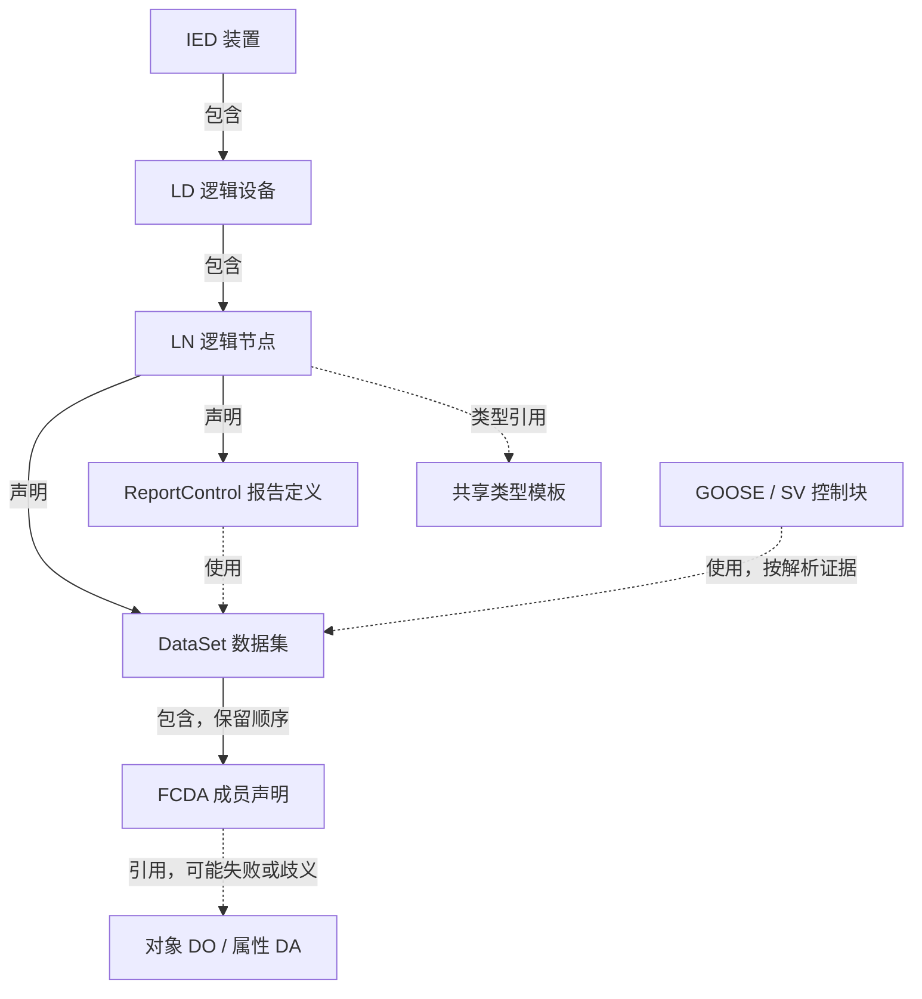

# Task7 · MMS 返回导航与高级视图关系展示

日期：2026-11-20。状态：**T7.0 基线通过；T7.1 功能修改完成、功能回归通过，性能对照未达门槛；T7.2–T7.5 尚未实施**。实际证据、性能对照与限制见 [T7.0](Task7T7.0.md) 和 [T7.1](Task7T7.1.md)，T7.1 未标整体通过，Task7 整体验收未通过。按用户最新要求停止追加测试。

本任务解决两个问题：MMS 查阅深入后能方便地返回；高级视图能解释对象的层级、归属与引用关系。沿用 Qt Widgets + ADS、现有不可变快照和后台查询，不新增协议通信或另一套 SCL 解析器。

## 1. 需求判断与本轮边界

需求清晰，足以开始方案和后续基线阶段，不需要用户先学习 SCL 或补充协议知识。建议产品目标为：**用户始终知道自己在哪里、从哪里进入、如何返回，以及当前内容属于谁、引用谁、被谁使用。**

有三处需要澄清，但不阻塞设计：

| 事项 | 核对结论与处理 |
| --- | --- |
| “没有返回” | 现有工作台已有全局“返回/前进”及 Alt+Left/Right，MMS 也已接入历史。缺口是 MMS 页内入口不醒目，且缺少语义明确的“上一级”。本期先复现可发现性与恢复问题，不预先认定历史完全失效。 |
| “数据集与成员有层级” | 正确：FCDA 成员声明位于数据集内部；但报告是引用数据集，成员又引用信号对象。不能把全部关系画成同一种父子树。 |
| 真实样本路径 | 本轮按最新要求使用 `D:/1Document/自动配置/电校scd/湖北武汉220kV电校培训变20261021.scd`。Task6 T6.3–T6.5 的实验室样本及历史结论不改写；Task7 在当前机器、同文件、同工具链重新建立基线。 |

2026-11-20 方案核对时，上述文件可访问，长度为 50,418,958 字节，当时仅核对元信息。随后 [T7.0](Task7T7.0.md) 已重新解析、核对 SHA-256、版本线索与覆盖，并完成三轮同机基线；未把旧阶段计数当成本轮结果。

### 1.1 优先级和交付内容

- **P0：MMS 页内返回。** 明确区分历史后退、上一级、分页；可点击业务路径；恢复原列表、选中项、筛选、字段与滚动位置。
- **P1：高级视图数据集层级。** 数据集可展开成员，成员保留原始序号和解析状态；概览提供范围、归属、直接内容及引用入口。
- **P1：双向关系。** 从报告进入数据集、从成员查目标、从数据集查使用方；跳转后能回到原上下文。
- **P2：一致性收尾。** 其他高级表增加相同关系摘要、帮助、图标和键盘入口，完成窄窗/DPI/大文件回归。

P0、P1 属于本任务必交付范围；P2 中关系摘要与可访问性也是收尾门槛，全工程图、新图引擎、全部技术表树化不在本期范围。不会把界面尚未支持的关联宣称为“没有关联”。

保持只读离线、无需 Redis。不得改动 `tools/Redis/` 迁移及运行配置，不新增独立依赖程序。本轮不交付完整 XSD、在线值、报告订阅、SCL 编辑、装置内部因果推断。Task3、Task5T5.6、Task6T6.5 和 Task1 P7 的未通过/待测边界继续保留。

## 2. 现状与设计依据

以下来自源码和已有记录的静态核对，不代替真实桌面验收。

| 位置 | 已有能力 | 本轮设计要解决的问题 |
| --- | --- | --- |
| `src/gui/SclWorkspace.cpp` | `SclBack`/前进、工作台路径、`Navigate`、统一历史、任务/高级视图切换 | 路径主要基于所选 XML 节点，无法充分说明报告→成员→地址的业务路线；全局按钮距离 MMS 操作区较远。 |
| `src/gui/SclMmsView.*` | `继续查阅`、独立上一页/下一页、路线下拉框、`Location`、`RestoreLocation`、`BeforeNavigate`/`Navigated` | `SclMmsBreadcrumb` 是纯文本标题；页内缺少上一级；统一的“继续查阅”没有说明将打开什么。 |
| `SclWorkspace` 高级区 | 概览文本、并列的报告/数据集/成员等 Tab，成员范围随数据集设置 | 需要切换 Tab 才能理解数据集与成员的联系，概览缺少按关系组织的入口。 |
| `src/core/SclMmsQuery.*` | 同快照报告/成员/地址/反查、有界分页与独立查询会话；`reportsByDataSet` 等索引 | 应复用身份及查询边界；高级数据集不能只显示被 MMS 报告使用的子集。 |
| `SclTaskIndex`、`SclReferenceResolver`、`SclDescriptionResolver` | 成员和信号身份、作用域、引用候选、描述与来源 | 归属和关联都从已有解析证据投影，不从名称猜测、不重复解析 XML。 |
| `tests/integration/MainWindowBaselineTest.cpp` | MMS 原文往返、成员/地址、客户端反查、搜索与过滤恢复等测试 | 增加上一级、直接进入、共享数据集、层级展开及真实可见区域断言。 |

技术资料核对：Qt 的 [QTreeView](https://doc.qt.io/qt-6/qtreeview.html) 支持模型驱动的层级呈现，[Fetch More 示例](https://doc.qt.io/qt-6/qtwidgets-itemviews-fetchmore-example.html) 演示按需分批交付。本项目只借鉴模型协议，数据准备仍在后台，不照搬示例的文件扫描。术语参考 libiec61850 官方的[数据集 API](https://support.mz-automation.de/doc/libiec61850/c/latest/group__IEC61850__CLIENT__DATA__SET.html)和[报告 API](https://support.mz-automation.de/doc/libiec61850/c/latest/group__IEC61850__CLIENT__REPORTS.html)：报告控制块引用、报告标识、数据集引用需要区分。这些资料不是本项目已接入在线服务的证明；后续涉及版本语义仍按现有规则及标准依据处理。

## 3. 面向初学者的关系模型

先教会用户区分三种关系，再决定界面表现：

| 关系 | 示例 | 界面表达 |
| --- | --- | --- |
| 包含/归属 | IED 内的逻辑设备、逻辑节点；数据集包含 FCDA 成员声明 | 缩进、展开箭头、明确的所属位置 |
| 引用/使用 | 报告使用数据集；成员引用对象或属性；LN 引用类型模板 | 带名称的关系入口、方向和解析证据；不作为真实 XML 子节点 |
| 查阅来源 | 从报告 A 打开共享数据集，再打开成员目标 | 业务路径与上一级，保留来源报告；不改变数据集实际归属 |



实线表示配置包含/声明，虚线表示引用。图只解释概念，不是全工程拓扑或在线流量。AP/Server/ServerAt 的完整路径在所属位置中保留，图中为便于理解作了简化。

帮助文案采用短句：“数据集是一份有顺序的数据引用清单。”“报告控制块引用这份清单，并声明报告配置。”“成员是清单中的一次出现，同一个信号可以出现多次。”“这里显示文件配置，现场运行情况尚未获取。”不将所有成员都称为某一单独属性；DO 级成员、结构、数组和属性成员分别标识。

## 4. MMS 导航设计

### 4.1 三种返回能力各司其职

| 控件 | 用户含义 | 行为与边界 |
| --- | --- | --- |
| 后退 / 前进 | 回到刚才看过的位置 / 恢复后退前的位置 | 页内入口调用现有工作台同一组命令，统一启用状态和历史；Alt+Left/Right 沿用现有绑定，不注册第二套冲突快捷键。 |
| 上一级：报告列表 / 数据集成员 / 信号对象等 | 返回当前查阅路线的父级 | 根据业务路线恢复父页，不是退一页数据，也不是直接取 XML parent；没有前序历史的直接进入也应有定义好的父级。 |
| 祖先路径链接 | 直接回到该路线的任意上层 | 每段有明确目标；当前段为普通文本；不把未经解析的字段变成可跳转链接。 |

分页按钮改为“上一页数据 / 下一页数据”，旁边显示“第 201–400 项”或受限下界，避免和“上一级”混淆。到顶层时上一级禁用并提示“已在当前 MMS 入口”，后退仍按历史状态启用。

页内保留三枚简洁导航按钮，后退/前进复用全局命令；上一级显示文字和目标。路径过长时中间折叠为可操作菜单，末段和直接父级优先可见，完整路径可复制。窄窗分两行放置导航与筛选，不提高最小窗口尺寸。所有名称按纯文本显示；若使用富文本链接，工程字段必须转义，链接只携带受校验的内部标识。

### 4.2 线框与动作名称

```text
MMS 查阅    范围：IED_A / AP1 / Server                 [全工程搜索]
[后退] [前进] [↑ 上一级：数据集成员]
IED_A › 报告上送 › 报告 brStatus › 数据集 dsStatus › 成员 #12
当前内容：成员对应的信号对象      来源报告：brStatus
[筛选当前列表……]            [查看属性与地址] [更多]
┌ 对象/说明 ──────┬ 类别 ──┬ FC ─┬ 解析状态/依据 ──────┐
│ ……             │ ……     │ ……  │ ……                  │
└────────────────┴────────┴─────┴─────────────────────┘
上一页数据 / 下一页数据                   第 1–200 项
属性与依据 / 原文：沿用现有详情 Dock，可收起
```

上一级按钮显示当前直接父页名称，不能使用固定目标文案。

将“继续查阅”按选中对象和当前可用动作改为“查看数据集成员”“查看信号对象”“查看属性与地址”“查看报告成员”等；无进一步层级时使用“查看字段与依据”。未知/歧义引用显示“查看候选与依据”，不能暗中选首个。动作不得承诺当前投影没有提供的能力。

### 4.3 父级路线规则

| 当前页/进入来源 | 上一级目标 |
| --- | --- |
| 报告的数据集成员 | 原报告列表，恢复来源报告和该列表状态 |
| 成员对应的信号对象 | 原数据集成员页，恢复来源报告、数据集及 FCDA 原始身份 |
| 从信号对象展开属性地址 | 原信号对象页；如来源是成员链，继续保留成员和报告上下文 |
| 报告的预期实例、客户端声明或局部图 | 该报告所在列表，恢复报告；不把客户端目标 IED 当成报告归属 |
| 客户端反查进入报告成员 | 原客户端反查列表和来源客户端身份，即使中间改变 IED 范围也可返回 |
| 独立信号地址入口展开属性 | 原信号目录，不伪造报告或数据集父级 |
| 全局搜索进入具体业务内容 | 有业务父级时上一级沿业务路线；搜索是“进入来源”，通过后退或“返回搜索结果”恢复，明确与上一级分开 |
| 外部/高级表直接定位到成员或地址，尚无路线栈 | 由同快照唯一身份构造最短父链：成员→所属数据集，地址→信号对象；没有唯一报告时停在数据集入口，不猜报告 |

面包屑是查阅路径，不冒充 XML 结构。报告→数据集一段可标“使用的数据集”；成员→信号一段可标“引用目标”。报告列表进入成员不强制增加一个只有单条数据的中转页。

### 4.4 历史和状态恢复契约

1. **复用统一历史。** 不在 MMS 新建独立后退栈。业务父链是当前导航位置的元数据，由统一历史保存；全局与页内后退产生完全一致的结果。每个父级保存其进入前状态，避免从当前子页反推出旧筛选条件。
2. 导航提交前保存当前状态；进入子级、父级、点击祖先、显式跨对象/跨视图跳转各形成一次历史导航。选择行、滚动、展开收起、分页、当前页筛选更新当前历史位置，不逐次制造大量后退站点。后退后执行新导航截断前进分支。该行为与现状的差异在 T7.0 冻结并在 T7.1 更新测试。
3. 保存同快照对象、IED/AP/Server、任务/高级模式、路线、报告键、数据集 NodeId、FCDA 原始序号/节点、信号路径/FC/数组语境、字段键、文本筛选、排序、页锚点、顶部记录及行内偏移、详情显隐和原文证据。不得以显示行号作为跨页、排序、筛选后的记录身份。
4. 来源报告 A/B 共用数据集时，成员数据可共享，路线和历史不能互相覆盖。同名数据集必须保留 LN、Server 和 AP 作用域；从数据集直接进入时不自动选择某个使用方。
5. 父页状态存在时精确恢复；直接进入没有旧状态时使用明确默认排序/空筛选，并定位目标身份。受筛选遮挡时清除旧行高亮，保留详情和“所选项被筛选隐藏 / 清除筛选”入口，不自动选首行。
6. 恢复期间取消旧列表/详情/地址请求，核验快照、范围、独立请求代次和路线身份。设置模型、恢复选中、滚动和字段完成后再发布稳定位置；禁止恢复回调生成第二次导航。
7. 切换或关闭文档清理路线、历史与关联缓存，确保旧快照可释放。仅允许本次会话恢复，不跨文件或重启复用 NodeId。

## 5. 高级视图设计

### 5.1 概览从统计文字变成“当前范围 + 关系入口”

保留工程统计，增加当前对象摘要，按阅读顺序展示：

1. **当前范围**：整个工程 / 当前 IED，完整所属路径，是否启用全部模板；与筛选范围明确区分。
2. **当前对象**：类别、名称、描述、来源状态；数据集显示成员声明数、已解析/歧义/未解析计数，控制块显示使用的数据集。
3. **直接内容**：当前范围的逻辑设备、逻辑节点、数据集、报告等入口，标明计数口径；点击进入相应内容并保留当前范围，不无意跳到任意首行。
4. **引用与使用方**：按“使用的数据集”“被报告使用”“被 GOOSE/SV 使用”“引用目标”“类型模板”等分组，显示方向、证据和有界结果入口。

工程总量、当前范围数量、筛选命中数量分开写。数据集数、成员出现次数、唯一信号对象数不能混为同一统计项；不知道精确总量时显示“已发现至少 N 项，结果受限”。加载中、无声明、未能解析、候选歧义、当前范围外、筛选无命中和资源受限分别有文字空态。

### 5.2 数据集采用树表，其他技术表保留

在原“数据集”页提供 `[层级浏览（默认） / 平面列表]`，复用同一数据投影；保留原“成员”页作为当前数据集的专用大表和兼容入口，避免一次替换全部高级表。

```text
高级视图 > 数据集     范围：IED_A       [层级浏览 | 平面列表]
名称 / 成员序号              描述          类别/FC     状态 / 数量
▾ LD0 / LLN0 · dsStatus      开关状态      数据集      253 次成员声明
    #1 XCBR1.Pos             断路器位置    DO / ST     已解析对象
    #2 XCBR1.Pos.stVal       位置状态      DA / ST     已解析属性
    #3 XCBR1.Pos.stVal       位置状态      DA / ST     重复出现，保留
    #4 ……                   ……            ……          候选歧义
    [加载后续 200 项……]                              已加载 200 / 253
▸ LD0 / LLN0 · dsMeasure     测量值        数据集      128 次成员声明

所选数据集：IED_A / AP1 / Server / LD0 / LLN0 / dsStatus
使用方：[报告 brStatus] [GOOSE gcb1] [查看全部使用方]
[查看所选项原文] [在成员专页打开] [定位引用目标]
```

全部名称与数量为合成示意，不来自指定工程。首列只表达“数据集→成员”两级；IED/LD/LN 以限定名称和所属列表达，避免同一页再复制一棵深层 XML 树。整个工程范围下同名项显示 IED/AP/Server/LD/LN 区分，排序使用限定身份和原始序号作稳定补充键。

- 数据集初始折叠，展开后后台取首批最多 200 个成员。数据集列表本身也分页，不在 GUI 建全工程树。后续批次通过显式“加载后续”行取回；该行不是工程节点，不能复制成成员或定位原文。
- 树表只把 FCDA 声明作为数据集的孩子，信号目标通过“定位引用目标”查看；同一目标重复出现不去重。DO 级成员的属性另行按需查阅，不伪装成原文中存在的额外 FCDA。
- 数据集选择不自动展开。展开箭头/键盘 Right 展开，Left 收起；单击选择更新现有详情，双击单元格复制完整值，不用于跳转或展开。Enter 和右键动作按 Task5 契约处理，原文入口独立。
- 层级与平面模式切换保留数据集/成员身份；成员不在已加载页时后台定位该页再呈现，不能只高亮其父项并宣称定位完成。
- 成员专页顶部固定显示所属数据集路径、成员声明数和返回数据集入口。离开数据集/FCDA 选择入口必须清空专页范围并取消旧筛选，不能依赖详情刷新；仅收起树中的父行不等于离开业务上下文，所选子项被收起时将选择移到其父数据集。
- 高级业务 Tab 继续按未应用文本筛选的范围内容数显示/隐藏；概览、搜索结果和仅被文本筛选遮挡的页面保留入口。隐藏当前页回概览并抑制默认行导航。
- 普通字段换行、可见行按需测高，继承字体/列宽/DPI 代次和滚动锚点；不以固定行高、省略号或全表反复测高换取树表性能。异常长值保留全值入口。

### 5.3 筛选和关系导航

“筛选当前数据集列表”和“筛选当前数据集成员”分别作用于父项字段与指定数据集的成员字段，输入框清楚显示范围。本期不做一个输入框隐式递归搜索全工程所有孩子。查找任意层级使用现有“全局搜索（整个工程）”，结果标注类别、所属路径及进入来源。

父项筛选不因孩子尚未加载而误报“没有成员命中”。若后续增加跨成员筛选，必须单列后台查询和命中计数，保留命中项的祖先；不能只过滤已加载的 200 行却称为全部结果。成员原始序号固定，不随筛选、排序或分页重新编号。

点击数据集“使用方”进入后台关系结果，再显式定位控制块；支持报告、GOOSE、SV 分类。使用方在别的 IED 时先标明目标归属，用户点击后才调整范围；后退恢复原 IED 和数据集。模板复用与同对象使用单列，候选不能写成确定绑定。“当前未发现使用方”不等于“工程无用配置”。

### 5.4 为什么这样选

| 方案 | 决策 |
| --- | --- |
| 只在高级区增加更多 Tab | 关系仍需用户在脑中拼接，不作为主要方案。 |
| 把报告→数据集→信号全部画成所有权树 | 会误导共享关系，不采用。 |
| 首屏展示全工程关系大图 | 大文件节点过多，阅读和布局成本高，不采用。 |
| 数据集树表 + 同页关系摘要 + 已有局部图入口 | 推荐：直接看见包含关系，再按需追引用；沿用原生组件和现有图能力。 |

局部图继续作为辅助入口，显示范围、边类型及受限提示；本轮不新增图引擎或把 QtNodes 作为前置条件。

## 6. 实施结构与资源约束

### 6.1 建议职责划分

名称为实施草案，可以并入现有模块；禁止为符合命名另复制数据/解析逻辑。

| 职责 | 建议落点 |
| --- | --- |
| 页内导航控件、目标动作文案 | `src/gui/SclMmsView.*`：发出命令、展示路线；不自行维护第二套历史。 |
| 业务父链/历史协调与恢复事务 | `SclTaskBrowser.*`、`SclTaskPages.*`、`SclWorkspace.*`：扩展现有 Location，保持任务/高级/原文共享导航。 |
| 数据集子页、使用方和身份定位查询 | `src/core/` 的现有 SCL 查询/会话，必要时增加 `SclHierarchyQuery.*`；仅消费已有快照及引用/索引。 |
| 层级 GUI 模型 | 可新增 `src/gui/SclDataSetTreeModel.*`，继承 `QAbstractItemModel`；`rowCount`/`data`/`hasChildren` 只读已交付的有界结果。 |
| 概览和关系摘要 | `SclWorkspace.*` 及现有详情/关系投影，后台准备完整值和证据。 |
| 回归 | 扩展 `MainWindowBaselineTest` 与应用服务测试；新增自建夹具覆盖共享、歧义、重复和大分页，不提交真实工程。 |

### 6.2 统一异步契约

每个结果绑定 `{快照对象, 范围, 请求代次, 父节点/路线身份, 查询类别}`。列表、展开、使用方、身份定位、详情使用独立请求身份；不得让某个列表请求取消另一消费者。取消时使用本请求的独立标记，隐藏/切范围/关闭时取消旧任务；节点已收起或代次变化的展开结果不重新打开旧分支。

初始拟定预算：每批最多 200 行，每次查询最多 100,000 工作单元；关系列表最多 512 条，MMS 局部图沿用 128 节点/256 边。GUI 树缓存最多 2,000 条记录，展开查询以单工作任务加最新待处理请求协调，不为每个树节点创建线程或无限队列。T7.0 量测后可下调预算，增加预算必须有同机证据。

连续展开多个节点时允许排队提示，但队列有界；被替换的展开请求清除“加载中”并提供重试。缓存淘汰采用最近最少使用顺序，保护当前选择和可见页；不能保护更多记录时先释放非活动分支，给出可重新加载状态，不突破上限。父项、孩子和关系入口计数均计入缓存口径。缓存键含快照、范围、父身份、排序、筛选和页锚点；完整值按需读取，不复制整个快照。

历史按稳定身份重新定位，不能依靠所有展开孩子永远留在内存。恢复只重建当前页、选中分支和有限展开集合，其他分支按需再取。触及预算显示已观察下界和缩小范围建议；若无法完成某个定位请求，明确“受限，尚未定位”，不高亮别的项。

### 6.3 Dock、样式和图标

本期复用原中央“概览与数据”和“属性与依据/原文”Dock，不新增持久化 Dock，内部 ADS 布局版本预期仍为 2。若实施中改变 Dock 结构，则在独立小步中增加布局版本、兼容恢复及重置测试，不能静默改格式。

优先复用现有 Qt 资源与系统标准导航图标；补充数据集、成员、包含、引用、使用方等语义图标时统一线条和尺寸，配中文文字/工具提示与可访问名称，不仅靠颜色区分状态。主题颜色遵循现有工作台及系统调色板，不全局重绘软件。

用户提供的 [Yesicon](https://yesicon.app/zh-Hans) 可作为图标检索入口，[Aha Icon](https://ahaicon.com/zh/) 可作文字图标样式参考。二者不代表检索到的每套图标都适用同一许可证；实施时核对具体集合的上游许可证。[IconMCP](https://iconmcp.com/?q=connection) 本轮网页读取未成功，不将其资源可用性列为实施前提。

若确需引入资产，在 `third_party/` 固定保存来源、版本/提交、许可证及所选原始资产，在 `res/` 通过 QRC 使用；不引入运行时网络请求。自制 SVG 直接入本地资源并注明项目自制。独立程序统一在 `tools/` 管理，本期无需新增。方案阶段不下载图标、不增加依赖，第三方记录暂无新增条目。

## 7. 分阶段执行计划

每阶段通过其门槛后再进入下一阶段；失败先修复本阶段，不将未验证的导航、查询和树表一次性接入。阶段记录分别写入 `docs/Tasks/Task7T7.0.md` 至 `Task7T7.5.md`，未执行时不预填通过。

| 阶段 | 工作与交付 | 验证门槛 |
| --- | --- | --- |
| **T7.0 现状复现与基线（已通过）** | 冻结当前提交/工作区差异、构建工具链、旧程序与隔离配置；在指定武汉 SCD 复现报告→成员→信号→地址→原文及高级数据集路径；记录截图、点击步骤和同机性能。补充导航状态表及最小合成样本。 | [实际记录](Task7T7.0.md)：Debug、清洁 PATH 13/13、三轮原生 Qt 程序驱动基线及指纹通过。独立鼠标检查被工具审批拒绝，未计人工通过；未归因卡顿。 |
| **T7.1 MMS 导航闭环（功能通过，性能未通过）** | 扩展 Location/父链，接入统一命令、页内后退/前进/上一级、可点击路径、动作名称、分页文案；精确恢复筛选、范围、选中、字段和锚点。 | [实际记录](Task7T7.1.md)：功能契约、13/13 CTest 及五档原生矩阵通过；最终三对有 4 条路径超过 +15%，未标整体通过，按用户要求停止追加测试。 |
| **T7.2 后台层级与关系查询** | 基于已有引用与分类索引提供数据集分页/成员子页/使用方/原始身份定位；补充独立代次和预算；领域层不增加 GUI 依赖。 | 253 及更多成员分页、重复 FCDA、跨 LN 同名数据集、共享使用方、DO/DA/数组、缺失/歧义/扩展节点、取消/范围切换、受限下界测试通过；查询不在 GUI 执行。 |
| **T7.3 高级层级表与概览** | 接入数据集树表/平面切换、成员专页上下文、范围概览与关系入口；维护原 Tab/成员作用域规则；按需测高和全值复制。 | 展开不改业务选择；双击只复制；加载行不当工程记录；按身份恢复子页；切范围/排序/筛选无旧行错位；旧高级表、详情收起、布局恢复回归通过。 |
| **T7.4 关系导航和帮助收尾** | 报告、数据集、成员、对象、模板及 GOOSE/SV 使用方的关系摘要和现有局部图入口一致化；补充短释义、图例、图标及键盘访问。 | 包含/引用/来源明确区分；候选不升级绑定，DO/DA/FC/数组边界不丢失；跨视图和跨 IED 往返正确；资源全部离线且许可证记录完整。 |
| **T7.5 综合与用户验收** | 同机同文件旧/新对照、十轮打开/查阅/关闭、三档 DPI/短窄窗/主题/跨屏与初学者走查；同步 README/AGENTS/DEVELOPMENT 及阶段结果。 | 下面的功能、性能和人工门槛均有证据；未测项保留待测，历史未通过项不被本任务覆盖。全部满足才标 Task7 整体通过。 |

T7.0 即可独立执行，不要求用户先选择实现类名或掌握标准细节。人工走查时间、显示设备及协作者可以在 T7.5 前安排；缺少这些信息不阻塞前面阶段。

## 8. 验收用例与指标

### 8.1 必测路径

1. 报告列表筛选并滚动→报告 A→成员第 2 页→成员信号→属性→字段原文；上一级逐层恢复，后退/前进保持相同身份、筛选和屏幕锚点。
2. 报告 A/B 共用数据集，分别往返；直接从高级数据集或搜索进入同一成员，返回来源正确且不伪造唯一报告。
3. 两个 LN 存在同名数据集；同信号有重复成员，成员序号、FC、数组语境均保持，不串父级。
4. 数据集树展开 253 个以上成员，加载后续、收起、重新展开、模式切换和缓存淘汰；所选目标可见，未加载内容不误报为空。
5. 切 IED/AP/Server、快速展开收起、连续返回、切视图、隐藏工作台、换文件和关闭；迟到结果不能重开分支或污染新文件，旧快照可释放。
6. 空数据集、未声明 datSet、悬空/歧义引用、结构/数组、未知版本、无客户端声明、受限结果；文案不推断在线状态或工程完整性。
7. 高级表和树表单击选择、双击完整值复制、Ctrl+C、独立原文入口、长值、中文和特殊字符；复制内容来自同快照身份，富文本/图标签不解释工程字段为代码。
8. 任务/高级切换、成员范围清除、Tab 隐藏和仅筛选零行行为、跨 IED 使用方与历史恢复；旧 ADS 布局有效，详情可收起，重置布局正常。

### 8.2 性能验收口径

以 **T7.0 冻结旧构建** 对照 Task7 新构建，使用同机、同武汉 SCD、同工具链/Debug 配置、同 QSettings 初始状态与固定操作脚本。交替运行，记录热身、每轮原始值和峰值工作集；不与另一设备或实验室样本混算。

建议门槛在 T7.0 冻结，不能事后为通过而放宽：

| 指标 | 方法与门槛 |
| --- | --- |
| 加载到 Ready、峰值工作集 | 至少 3 个有效基线/新构建轮次，中位数增幅各不超过 15%；超限先归因，不以导航改善豁免。 |
| 重复导航与返回 | 每条关键路径热身后至少 30 次有效操作，从用户动作到目标行/字段可见取端到端 P95；新/旧同操作不超过 15% 增幅，页内返回目标另以 P95 ≤ 200 ms 验收。达不到时本阶段记录失败及热点。 |
| 树展开与成员翻页 | 单列后台耗时、GUI 交付、测高及端到端；首批/后续页端到端 P95 目标 ≤ 200 ms。不能只测 GUI 信号发出时间。 |
| GUI 响应 | 用 GUI 心跳及交付计时发现超过 100 ms 的停顿并追踪原因；连续操作不得出现秒级无响应。离屏通过只作回归，实体桌面单列。 |
| 有界内存与释放 | 验证树缓存 ≤ 2,000 条、任务/队列上限和预算提示；十轮打开/导航/关闭后快照释放，工作集无随轮次持续增长趋势。 |

200 ms、100 ms 是本轮建议目标，不是当前实测结论。若硬件或文件特性使目标不合理，只能在 T7.0 基线记录中以证据修订后再冻结，不能到验收末尾改口径。新增路径无旧版对应操作时单列绝对指标，不能编造改善比例。性能归因遵循 Task3，不盲目重建索引或引入全量预计算。

### 8.3 真实桌面与初学者走查

在 100%/150%/200% 下检查实际可见行、字段、原文锚点和导航按钮；至少覆盖 620×560 短窄窗、正常宽窗、详情收起、浮动 Dock、系统亮/暗/高对比及实体跨屏。模拟调色板和离屏渲染不能替代系统主题、实体跨屏结论。

邀请 3 名不熟悉 SCL 的用户，在少量概念说明后各自完成：找到一个报告的成员；查一个数据集被谁使用；深入到信号原文再返回；解释数据集包含与报告引用的区别。每人都应无需开发人员指路找到上一级；其他任务记录成功率、耗时、误操作及原话，存在阻断问题则修复复测。真实工程缺少某种场景时用明确标注的自建样本补测，不向真实 SCD 写入示例配置。

自动化用自建夹具和隔离 QSettings；本地真实样本只读，日志/截图按现有忽略规则管理，不上传、不提交工程内容。人工未执行时保留“待测”，不能用测试通过数代替产品可用性验收。

## 9. 后续 AGENT 的执行指令模板

按下述形式逐阶段推进；这是一份执行模板，不表示本轮已开始实现：

> 按 docs/Tasks/Task7.md 仅执行 T7.0。先读 AGENTS.md、README.md、docs/DEVELOPMENT.md 和 Task6 当前结论；检查工作区并保留用户改动。使用本轮指定武汉 SCD 做本地只读复现，冻结同机同文件旧构建、导航步骤与性能基线，记录为 docs/Tasks/Task7T7.0.md。不要修改产品交互，不动 Redis 迁移和配置，不上传工程。明确写出通过、失败、未执行及后续阻塞；只有 T7.0 门槛通过后才进入 T7.1。

后续替换为对应阶段，先检查上阶段证据；每阶段输出“实际改动、验证方法与结果、未完成项”，并及时同步说明文件。涉及产品选择时优先遵循本方案的默认决策；只有发现无法兼容的真实行为或标准语义缺口时，提供具体证据与可选方案再讨论。

需求核对、方案及 T7.0 基线已完成；T7.1 已实现导航闭环并通过功能回归，详见 [阶段记录](Task7T7.1.md)。本轮没有进入 T7.2，没有下载图标或新增第三方依赖。
