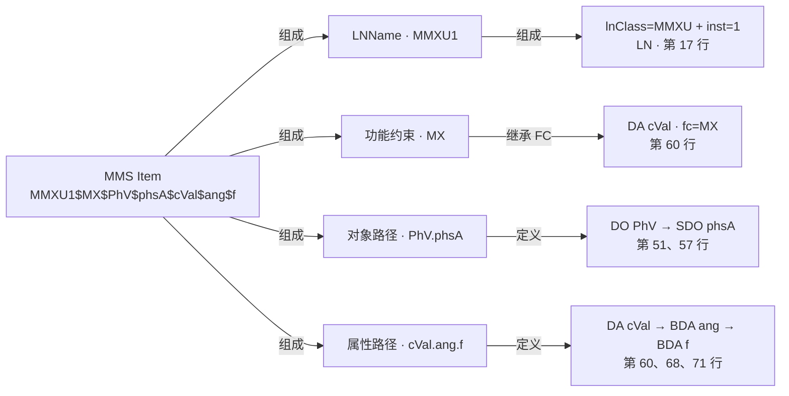

# Task9 · 从 SCD 追溯引用组成

2026-11-22。[T9.0](Task9T9.0.md) 基线、[T9.1](Task9T9.1.md) 证据投影和 [T9.2](Task9T9.2.md) 界面试点已通过。[T9.3](Task9T9.3.md) 记录全入口回归、指定 SCD 原生走查和待进行的初学者试用。功能基线见 [Task8](Task8.md) 和 [T8.4](Task8T8.4.md)。

## 1. 需求确认

需求清晰，可以按阶段实施，无需补充信息。用户从 Task8 的右键菜单选择一个引用值，应能回答三个问题。

1. 这个值由哪些部分组成，每部分叫什么？
2. 这些部分是从文件直接取出、沿引用查得，还是按规则组合的？
3. 能否打开同一份 SCD 的原文，看到支持该结论的属性、标签层级和行号？

二级菜单保留原有的点击复制，并在同一级增加「查看关系」。菜单负责进入查阅，节点图负责逐层展开。这里的「关系」指**当前引用的组成、定义与原文依据**。Task2 的全局拓扑入口继续用于查看使用方和共享关系。首期覆盖对象引用、功能约束（FC）、MMS Domain、MMS Item 和类型引用，在 Task8 已有的任务视图与高级视图入口分批接入。是否要用 QML 或浏览器属于实现选择。按现有工作台复用 Qt Widgets 的方案即可开始。

用户无需指定装置或字段。验收先使用自建 A 相电压样本核对确定结果，再从指定 SCD 中选取具有足够证据的实例。如需验证某台装置或某条工程点表，可补充 IED、AP 和信号名称作为附加验收条件。

## 2. 查阅流程

```text
右键命中属性行
  └─ MMS Item
       ├─ MMXU1$MX$PhV$phsA$cVal$ang$f        单击复制
       └─ 查看关系                            打开该值的来源图
```

- **选择引用。** 每个有证据的二级分组提供「查看关系」。分组有多个值或多个来源时，先在查阅页按完整值、适用范围、声明层级或行号选择。单值且来源明确时直接展示。复制时保留 Task8 的值预览、完整剪贴板内容和键盘交互。缺少适用字段时沿用既有菜单，已知存在但未解析的引用若有原始声明，则可查其声明和失败原因。
- **读懂结果。** 复用 SCL 工作台中央区域和现有详情与原文入口。打开后在顶部显示字段名、完整值、当前目标层级及 IED/AP/Server 上下文。图从结果节点和一层直接组成项开始，按公式次序排列。点击一个片段在详情显示「这一段是什么」「如何取得」以及对应的原文入口。点击节点的展开按钮逐层显示下一层依据，已展开的分支保留。
- **查看依据。** 节点显示定义或推导，连线写明「组成」「声明」「引用定义」「继承 FC」或「位于」。详情显示原始属性、标签层级、原文片段和行号。只有显式点击「查看原文」才跳转；选中或展开节点时保留业务选择。提供「适应视图」「仅看首层」和键盘可操作的「证据树」，证据树与图共享选择，窄窗可直接使用树查看全部已交付信息。
- **返回原表。** 「返回来源」与工作台统一历史对接，恢复原视图、IED/AP/Server、选中项、筛选、页和滚动锚点。右键命中的记录作为溯源对象，即使此前选中的是另一行。选择证据、展开和缩放不逐次写入历史。查看原文后可回到图中原节点。切换文档或关闭工作台时清除旧图和历史中的旧引用上下文。

## 3. 五类字段的解释规则

以下公式只描述当前程序已支持并已解析的引用形态。对其他形态，展示已确认的部分及当前映射限制。SCL 配置与 MMS 映射分别有各自的规范语境，具体证据以本项目已有解析和投影为准。 [IEC 61850-6](https://webstore.iec.ch/en/publication/103863) · [IEC 61850-8-1](https://webstore.iec.ch/en/publication/66585) · [Task8](Task8.md)

| 二级分组 | 第一层展开 | 继续展开到原文 |
| --- | --- | --- |
| 对象引用 | 在普通信号路径中标出 `LDName / LNName . DO[.SDO…][.DA[.BDA…]]`。注明当前是对象、结构成员还是叶属性。 | `LDName` 展开名称来源和所属 IED/AP/Server；普通 `LNName` 展开 `prefix`、`lnClass`、`inst`，区分省略、显式空值及解析器识别的 LN0；DO/SDO/DA/BDA 各段对应当前实例解析到的声明。若从 FCDA 进入，并列显示 FCDA 原声明及解析到的目标，`lnInst` 和 LN 的 `inst` 分别标注。 |
| 功能约束 | 展示有效 FC 及业务解释，例如 `MX` 对应测量量。区分成员声明、定义和继承。 | FCDA 有 `@fc` 时显示声明。具体属性的有效 FC 追到所属 `DA/@fc`，嵌套 BDA 显示继承链。DO 级成员保留其成员 FC 和对象边界；FC 冲突时显示两端证据及解析状态。 |
| MMS Domain | 标出当前映射的 Domain 对应的 LD 名及其所在 Server。 | 显式路径展示 `LDevice/@ldName`。按现有规则推导时展示 `IED/@name + LDevice/@inst`，分别给出处，说明两段之间没有分隔符。如经 AP 别名访问，有已解析证据时展示别名到实际 Server 的关系。 |
| MMS Item | 对已映射的普通信号标出 `LNName`、FC、各级对象或属性片段及 `$` 分隔符。 | 各片段复用 LN 名、FC 与 DO/DA 的依据，分隔符说明来自映射规则。结构成员以当前层级为止。数组沿用现有地址形态，展开 `count`、原始 `ix`、已解析下标与 alternate access 组件。报告定义等异形 Item 按其已有投影展开 LN、`RP/BR` 和控制块名称。 |
| 类型引用 | 展示被选中的源属性、所引用的类型 ID 和解析状态。 | 逐跳呈现 `LN/@lnType → LNodeType/@id`、`DO/SDO/@type → DOType/@id`、结构 `DA/BDA/@type → DAType/@id`，或已解析的枚举类型。每跳分别标明声明和定义。模板行从该声明开始，模板复用按已知上下文呈现。 |

原始属性和派生值分开显示。有效的显式 `ldName`、推导默认名、文件中的可选字段和命名分隔符各有自己的来源说明。只有唯一解析的目标画为确定连线。遇到缺失、歧义、冲突、不适用和受限时，在对应分支写清停止位置与原因。候选可各自查看出处，保留候选状态。数组未选元素时显示待选状态，依现有规则保留结构地址。所有 MMS 地址标为文件模型的离线映射，在线状态沿用「未验证」。

### 合成示例

用 [Task8Voltage.scd](../../tests/fixtures/scl/Task8Voltage.scd) 中 `DemoListed` 的 A 相电压相位展示。该快照的对象引用为 `ListedMeasurements/MMXU1.PhV.phsA.cVal.ang.f`，MMS Domain 为 `ListedMeasurements`。以下行号仅供解释示例，产品从当前快照索引读取位置。



继续展开时，`MMXU1` 的详情显示该 LN 没有声明 `prefix`；`BDA ang` 的详情显示 `type="AnalogFloat"` 如何指到相应 `DAType`。查看 Domain 会落到第 7 行的 `LDevice/@ldName`；换成 `DemoUnlisted` 则从其 `IED/@name` 和 `LDevice/@inst` 得到 `DemoUnlistedLD0`。第 11 行的 FCDA 声明到 `PhV.phsA`，其溯源图停在对象层。相位叶属性可从自己的 MMS 属性行查看，二者的匹配沿用 Task8 的「DO 级覆盖」证据。

## 4. 实现方案

### 技术选择

首期用 Qt Widgets、现有 ADS 工作区及 `QGraphicsView/QGraphicsScene`。借鉴参考项目的卡片、连线和缩放交互，沿用 T5.5 收发关系图在本项目中验证过的布局方式。QtNodes 提供可独立于场景使用的图模型，NodeLink 提供可定制的 QML 节点、连线和缩放，两者可作为交互参考。本轮按只读局部图的实际需求选用现有 Qt 组件。 [Qt Graphics View](https://doc.qt.io/qt-6/graphicsview.html) · [QtNodes](https://github.com/paceholder/nodeeditor) · [NodeLink](https://github.com/Roniasoft/NodeLink) · [T5.5](Task5T5.5.md)

本任务的工作区为 `C:/Code/IEC61850Simulator`。依赖库备份目录为该工作区的 `third_party/`，独立程序管理目录为 `tools/`。如后续确需引入绘图库，另按 T5.5 约定完成固定版本、许可证、离线构建及部署评估，再登记至 [第三方依赖记录](../../third_party/DEPENDENCIES.md)。

### 数据与边界

1. **从命中记录拿到引用身份。** 在 `SclReferenceMenu` 和 `SclTableInteraction` 共用入口扩展。保留 `SclReferenceRequest` 的表格命中上下文，绑定快照、字段类型及原记录、声明或字段键；MMS 记录保留父报告、FC、数组和 IED/AP/Server 语境。现有复制投影会按「字段类型 + 文本」去重。关系入口另外保留同文本的不同声明和路径，切勿通过菜单字符串反查，也不能用显示行号或 `DisplayRole` 重建身份。
2. **在应用服务后台生成依据。** 顺着 `SclSnapshot` 中的 `ReferenceAnalysis`、`FcdaTrace`、MMS 行的模板路径与映射证据、类型引用索引和 `SourceIndex` 查询，只处理当前根与展开请求。按字段形态复用解析器和既有投影，补齐所需的结构化证据；如果某处只交付最终字符串，先补该层的来源再开放对应分支。图的根值与同记录 Task8 复制结果逐字一致。以有序片段表达组合方式，由后端给出其语义和出处。
3. **用同一份投影驱动图和证据树。** 节点携带身份、完整值、角色、解析状态及依据。连线携带语义和证据。一个证据可包含快照内 `NodeId`、属性键、标签路径、已确认的源码位置和定位精度。当前 `SourceIndex` 支持开始标签锚点，属性跨行且没有精确位置时显示标签起始行，并列出待核对的属性名。原文预览复用有界预览，跳转前核验当前快照。没有可用位置时明确显示。
4. **以按需展开控制工作量。** 首屏只请求根及直接分支，内部展开按独立请求身份交付。可先沿用现有局部图 80 节点、160 边的规模作为起始预算；到界后提示限制并能折叠其他分支后继续。回访路径中出现循环时展示已访问节点与停止原因。快照、范围或根更换，图关闭或分支折叠时取消相应旧请求；迟到批次不得写入当前图。菜单关闭只结束菜单投影，已打开的图有独立生命周期。图渲染只接收有界数据，耗时仅记录用于定位可见卡顿，不设新 P95 门槛。

本期为离线只读查阅。工程数据及原文留在本机；使用已有工作区和原文 Dock，内部 ADS 布局沿用版本 2。

## 5. 执行与验收

逐阶段通过后进入下一阶段。将实际结果、失败原因和样本覆盖记录到对应阶段文档。

| 阶段 | 实施内容 | 通过条件 |
| --- | --- | --- |
| T9.0 冻结菜单与证据基线 | 在独立 Debug 构建中复现 Task8 的 MMS 属性表、任务报告使用表与高级 FCDA 树表。整理五类字段现有提供方，记录哪些只有单点依据，哪些可复用完整轨迹。使用 `Task8Voltage.scd` 冻结合成期望。 | 基线复制与原文正常。菜单矩阵列出各字段、可能的多来源和空态。固定显式/推导 LD 名、普通 LN/LN0、叶属性与 DO 级成员的区分。 |
| T9.1 实现结构化证据投影 | 支持五类字段的组成、按步查询和原文锚点。合成覆盖补足同文本不同来源、带前缀的 LN、缺失/歧义类型、FC 冲突、数组和同名跨 IED/AP 的案例。 | 五类根值与 Task8 逐字一致；每个名称片段能追到正确声明，推导分支列全输入和规则。DO 级 FCDA 保持对象层。验证多行标签的定位精度、候选保留、预算和取消。 |
| T9.2 完成节点查阅试点 | 在 MMS 属性表与高级 FCDA 树表先接入二级菜单、选择来源、逐层展开、证据树、原文与返回。 | 右键命中非选中行仍打开正确根。普通窗和短窄窗可从根展开到 FC、LN/LD 名或一个模板声明并看见原文。菜单键或 Shift+F10 可进入，图或证据树可继续操作。返回恢复来源表状态。旧复制不改选中项、原文或历史。 |
| T9.3 扩展菜单并验收 | 按 T9.0 矩阵接入其余五类字段提供方，补回归。运行清洁 PATH 下的 Debug 和完整 CTest，再走查指定本地 SCD。同步项目说明与实现记录。 | 字段在适用入口均可查到来源，受限和不适用状态可辨。换文档、切范围、重排或关闭后，迟到结果无法打开错误记录或更新当前图。通过下述走查，记录实际覆盖和人工完成情况。 |

给开发 Agent 的首个指令可用「按 Task9 执行 T9.0。用当前工作区独立 Debug 构建复现 Task8，运行 `SclMmsAttributeWorkflow` 和 `SclReferenceMenus`，把五类字段的入口与依据矩阵写入 `docs/Tasks/Task9T9.0.md`，记录通过项和缺口。」下一阶段以该矩阵和证据缺口作为实现输入。

### 指定 SCD 本地走查

- 样本使用 `D:/3Document/湖北武汉220kV电校培训变20261021.scd`，通过 `IEC61850_LOCAL_SCL` 显式传入本地验收，仅只读。常规 CTest 只使用自建样本。读前后核对指纹，日志记录汇总及结果，工程片段与截图保留在本机受忽略的构建目录。
- 沿 T8.4 已建立的路径选一台含 `PhV.phsA` 报告成员的 IED。进入相位属性，从 MMS Item 展开 LNName 和 FC，核对实际 LN、DA/BDA 与原文行号，再从 Domain 追查该工程的 LD 名来源。用完整剪贴板文本对照图的根值。
- 从高级 FCDA 树表查「对象引用」，核对成员的声明层级。再查相位叶属性的引用与类型链，明确两者的范围。真实样本中的精确叶属性 FCDA 缺少验收证据，使用合成样本补足。查询受限时仅核对交付到的记录。
- 请一名初次接触 SCL 的试用者尝试指出 Item 中哪一段是 LNName、找到 FC 的原文声明，并从 Domain 说明 LD 名的来源。记录独立完成与需要提示的步骤。功能试点和人工走查分别记录。
